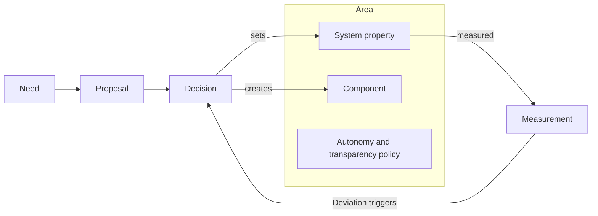

# Data Model (Draft)

As of: 2026-11-21. Living version with comments: [Claude Doc](https://claude.ai/artifact/KL61wynyE9kWLyiY4UBcsk).

The data model describes what a system should deliver, never how it is built. It is the single
source of truth of Remit. Connected tools only receive copies.

## Overview



Every Component traces back via a Decision to a Need (or a Deviation).
All Areas together form the system.

## System, Area, Component

The Area is the unit to which autonomy and transparency apply. Components are created by the AI;
the TPO sees them in the system map but does not maintain them.

| Entity | Field | Meaning |
| --- | --- | --- |
| System | `name`, `description` | e.g. "Online shop" |
| System | `tpo` | responsible person |
| System | `tenant`, `environments` | the customer's Azure tenant; prod, test |
| Area | `name` | e.g. "Catalog and search", "Customer data", "Payment" |
| Area | `protectionNeed` | low, medium, high |
| Area | `policy` | reference to the Policy |
| Area | `responsible` | person, default is the TPO |
| Component | `name`, `kind` | service, data store, cache, interface, external |
| Component | `status` | planned, active, decommissioned |
| Component | `dependencies` | other Components |
| Component | `resources` | Azure resource IDs, as references only |
| Component | `originatedFrom` | the Decision that created it |

## Need

| Field | Meaning |
| --- | --- |
| `id`, `title`, `description` | e.g. B-042 "Faster response times in the online shop" |
| `system`, `affectedAreas` | where the Need takes effect; the AI may add Areas |
| `requestedBy`, `priority` | person or business unit; high, medium, low |
| `source` | manual or ticket system with external ID |
| `currentState` | optional: references to Measurements |
| `status` | see lifecycle |

Lifecycle: New → In analysis → Proposal available (→ Rejected) → Properties set →
In implementation → In operation → Closed (properties continue to apply permanently).

## Proposal and Option

`requiredProperties` determines which fields the TPO must fill in on acceptance.

| Entity | Field | Meaning |
| --- | --- | --- |
| Proposal | `need`, `createdBy` | reference and agent |
| Proposal | `analysis` | cause in domain language |
| Proposal | `options`, `recommended` | Options and recommendation |
| Proposal | `status` | open, accepted, rejected, TPO question |
| Option | `title`, `description` | e.g. "Cache for catalog and search" |
| Option | `expectedEffect` | metric and value |
| Option | `cost` | range in € per month |
| Option | `risks` | list |
| Option | `requiredProperties` | types the TPO must set |
| Option | `affectedAreas` | determines which Policy applies |

## System property

A measurable rule that applies permanently until the TPO changes it.

| Field | Meaning |
| --- | --- |
| `appliesTo` | system, Area or Component |
| `type` | see below |
| `rule` | metric, operator, value, unit, e.g. `p95_response_time <= 250 ms` |
| `measurementSpec` | source, percentile, time window |
| `bindingness` | **must** or **should**; in a conflict, "should" gives way first |
| `validity` | optional from/to (e.g. Black Friday exception) |
| `responsible` | person, default is the TPO |
| `originatedFrom` | the Decision that set it |

| Type | Example | Measured via |
| --- | --- | --- |
| Performance | p95 response time ≤ 250 ms | Application Insights |
| Availability | ≥ 99.9 % per month | health checks |
| Freshness | prices at most 60 s old | age of the cache entries |
| Exclusion | stock level never from the cache | rule check during build |
| Failure behavior | on cache failure, continue more slowly | chaos experiment |
| Recovery | RTO 15 min, RPO 1 h | chaos experiment or incident |
| Budget | ≤ €250 per month | Azure Cost Management |
| Location | EU regions only | Azure Policy |

Two conflicting "must" properties are never resolved by the AI – they always become a TPO question.

## Autonomy and transparency policy

One Policy per Area. Only the TPO may change it.

| Autonomy | The AI … | Enforced via | SRE Agent mode |
| --- | --- | --- | --- |
| 1 | proposes, implements nothing | read permissions only | Review |
| 2 | implements after approval of each step | approval in Remit | Review |
| 3 | decides on its own within the properties | write permissions on the Area, limited by Azure Policy | Autonomous |
| 4 | also adjusts "should" properties and reports | as 3, plus the right to change "should" properties (Remit) | Autonomous |

| Transparency | The AI shows |
| --- | --- |
| 1 | result: target and actual, cost |
| 2 | additionally every Decision with its rationale |
| 3 | additionally the data flow: which data where, who accesses it, retention period, encryption, outflow |

| Area (example) | Autonomy | Transparency | Rationale |
| --- | --- | --- | --- |
| Catalog and search | 3 | 1 | limited, reversible, no personal data |
| Payment | 2 | 2 | errors cost revenue directly |
| Customer data | 1 | 3 | not reversible, GDPR accountability |

Always a TPO question, regardless of the level: conflicting "must" properties, a change of
data location, budget overrun, outage longer than the RTO.

Fields: `autonomy`, `transparency`, `escalationRules`, `approvedBy`.

## Decision

| Field | Meaning |
| --- | --- |
| `kind` | AI Decision or TPO Decision (TPO question) |
| `reference` | Need, Proposal, property, Component or Deviation |
| `question`, `options` | TPO questions only |
| `chosen`, `rationale` | chosen solution and why |
| `effects` | changed Components and properties |
| `level` | autonomy level at the time |
| `decidedBy`, `timestamp` | agent or person |
| `implementation` | references only: pull request, deployment |
| `reversible` | yes/no, and how |
| `deadline`, `defaultOption` | TPO questions only: by when, and what happens without an answer |
| `rating` | later: good, neutral, bad |

The ratings yield a success rate per Area. Above a threshold configurable per system,
Remit proposes a higher level.

## Measurement and Deviation

| Entity | Field | Meaning |
| --- | --- | --- |
| Measurement | `property`, `value`, `measuredAt`, `source` | measured values stay in Azure Monitor, only references/aggregates here |
| Property (computed) | `state` | met, at risk (forecast), violated |
| Deviation | `kind` | violated, forecast, drift |
| Deviation | `detectedAt`, `detectedBy` | timestamp, agent |
| Deviation | `measure` | reference to the follow-up Decision |

Drift = the system no longer matches the Decisions (e.g. a manual change in the portal).

## Role interfaces

| Role | Receives | Returns | First implementation |
| --- | --- | --- | --- |
| Ticket system | status, result of a Need | new Needs, comments | internal, later Jira / Azure Boards |
| Build agent | Option, properties, Policy | Components, Decisions, references | GitHub Copilot coding agent + Bicep |
| Repository | only via the build agent | references | GitHub |
| Operations agent | properties, Policy, escalation rules | Measurements, Deviations, Decisions, TPO questions | Azure SRE Agent |
| Measurement source | measurement specs | measured values | Application Insights, Azure Monitor, Cost Management |
| Documentation | copies of Decisions and properties | – | later Confluence |

The agents read properties and Policies via Remit's MCP server.

## Storage

- **Event store** (append-only): Decisions, changes to properties and Policies,
  status changes of Needs. Yields versioning and audit automatically.
- **Tables** (projections): current state for UI and queries.
- **Not stored:** raw measured values (they stay in Azure Monitor).

## Example: Cache for the online shop

```yaml
need:
  id: B-042
  title: Faster response times in the online shop
  source: { kind: ticket-system, external: KUNDE-318 }
  areas: [catalog-and-search]
  status: in-operation

proposal:
  need: B-042
  analysis: Repeated, identical catalog queries to the database
  recommended: cache
  options:
    - id: cache
      expectedEffect: { p95_response_time: 200 ms }
      cost: 150-200 EUR/month
      risks: [stale prices possible]
      requiredProperties: [freshness, exclusion, failure-behavior, recovery, budget]
    - id: cdn
    - id: scale-up-db

decisions:
  - kind: tpo
    chosen: cache
    sets: [E1, E2, E3, E4, E5, E6]
  - kind: ai
    level: 3
    chosen: Azure Managed Redis, West Europe
    rationale: Cheapest option that meets E1 and E6
    creates: [catalog-cache]
  - kind: tpo-question
    question: Black Friday – target and budget cannot both be met
    options: [raise-budget-once, relax-target, simplify-search]
    deadline: 2026-11-25
    defaultOption: relax-target

properties:
  - { id: E1, type: performance, rule: p95_response_time <= 250 ms, bindingness: must }
  - { id: E2, type: freshness, rule: price_age <= 60 s, bindingness: must }
  - { id: E3, type: exclusion, rule: stock level never from cache, bindingness: must }
  - { id: E4, type: failure-behavior, rule: on cache failure read directly from database }
  - { id: E5, type: budget, rule: cost <= 250 EUR/month, bindingness: must }
  - { id: E6, type: location, rule: EU regions only, bindingness: must }

policy:
  area: catalog-and-search
  autonomy: 3
  transparency: 1
```

The TPO question arises because E1 and E5 are both "must" and cannot be met together on
Black Friday. The default option applies if the TPO does not answer by the deadline.
