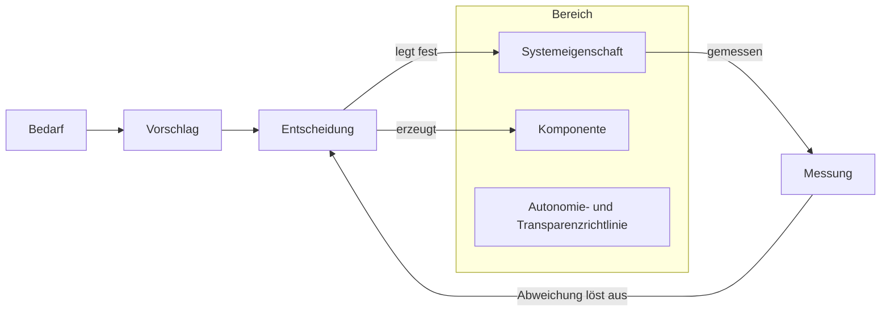

# Datenmodell (Entwurf)

Stand: 2026-11-21. Lebende Fassung mit Kommentaren: [Claude Doc](https://claude.ai/artifact/KL61wynyE9kWLyiY4UBcsk).

Das Datenmodell beschreibt, was ein System leisten soll, nie, wie es gebaut ist. Es ist die einzige
Quelle der Wahrheit der Kommandozentrale. Angebundene Tools erhalten nur Kopien.

## Überblick



Jede Komponente geht über eine Entscheidung auf einen Bedarf (oder eine Abweichung) zurück.
Alle Bereiche zusammen bilden das System.

## System, Bereich, Komponente

Der Bereich ist die Einheit, für die Autonomie und Transparenz gelten. Komponenten legt die KI an;
der TPO sieht sie in der Systemkarte, pflegt sie aber nicht.

| Entität | Feld | Bedeutung |
| --- | --- | --- |
| System | `name`, `beschreibung` | z. B. „Online-Shop“ |
| System | `tpo` | verantwortliche Person |
| System | `tenant`, `umgebungen` | Azure-Tenant des Kunden; Prod, Test |
| Bereich | `name` | z. B. „Katalog und Suche“, „Kundendaten“, „Zahlung“ |
| Bereich | `schutzbedarf` | niedrig, mittel, hoch |
| Bereich | `richtlinie` | Verweis auf die Richtlinie |
| Bereich | `verantwortlich` | Person, Standard ist der TPO |
| Komponente | `name`, `art` | Dienst, Datenspeicher, Cache, Schnittstelle, extern |
| Komponente | `status` | geplant, aktiv, stillgelegt |
| Komponente | `abhängigkeiten` | andere Komponenten |
| Komponente | `ressourcen` | Azure-Ressourcen-IDs, nur als Verweis |
| Komponente | `entstandenAus` | erzeugende Entscheidung |

## Bedarf

| Feld | Bedeutung |
| --- | --- |
| `id`, `titel`, `beschreibung` | z. B. B-042 „Schnellere Antwortzeiten im Online-Shop“ |
| `system`, `betroffeneBereiche` | wo der Bedarf wirkt; die KI kann Bereiche ergänzen |
| `angefragtVon`, `priorität` | Person oder Fachbereich; hoch, mittel, niedrig |
| `quelle` | manuell oder Ticketsystem mit externer ID |
| `istZustand` | optional: Verweise auf Messungen |
| `status` | siehe Lebenszyklus |

Lebenszyklus: Neu → In Analyse → Vorschlag liegt vor (→ Abgelehnt) → Eigenschaften festgelegt →
In Umsetzung → In Betrieb → Abgeschlossen (Eigenschaften gelten dauerhaft weiter).

## Vorschlag und Option

`benötigteEigenschaften` bestimmt, welche Felder der TPO beim Annehmen ausfüllen muss.

| Entität | Feld | Bedeutung |
| --- | --- | --- |
| Vorschlag | `bedarf`, `erstelltVon` | Bezug und Agent |
| Vorschlag | `analyse` | Ursache in Fachsprache |
| Vorschlag | `optionen`, `empfohlen` | Optionen und Empfehlung |
| Vorschlag | `status` | offen, angenommen, abgelehnt, Rückfrage |
| Option | `titel`, `beschreibung` | z. B. „Cache für Katalog und Suche“ |
| Option | `erwarteteWirkung` | Messgröße und Wert |
| Option | `kosten` | Spanne in € pro Monat |
| Option | `risiken` | Liste |
| Option | `benötigteEigenschaften` | Typen, die der TPO festlegen muss |
| Option | `betroffeneBereiche` | entscheidet, welche Richtlinie gilt |

## Systemeigenschaft

Messbare Regel, die dauerhaft gilt, bis der TPO sie ändert.

| Feld | Bedeutung |
| --- | --- |
| `giltFür` | System, Bereich oder Komponente |
| `typ` | siehe unten |
| `regel` | Messgröße, Operator, Wert, Einheit, z. B. `p95_antwortzeit <= 250 ms` |
| `messvorschrift` | Quelle, Perzentil, Zeitfenster |
| `verbindlichkeit` | **muss** oder **soll**; bei Konflikt weicht „soll“ zuerst |
| `gültigkeit` | optional von/bis (z. B. Black-Friday-Ausnahme) |
| `verantwortlich` | Person, Standard ist der TPO |
| `entstandenAus` | festlegende Entscheidung |

| Typ | Beispiel | Gemessen über |
| --- | --- | --- |
| Leistung | p95-Antwortzeit ≤ 250 ms | Application Insights |
| Verfügbarkeit | ≥ 99,9 % pro Monat | Health-Checks |
| Aktualität | Preise höchstens 60 s alt | Alter der Cache-Einträge |
| Ausschluss | Lagerbestand nie aus dem Cache | Regelprüfung im Bau |
| Ausfallverhalten | bei Cache-Ausfall langsamer weiter | Chaos-Experiment |
| Wiederherstellung | RTO 15 min, RPO 1 h | Chaos-Experiment oder Incident |
| Budget | ≤ 250 € pro Monat | Azure Cost Management |
| Standort | nur EU-Regionen | Azure Policy |

Zwei kollidierende „muss“-Eigenschaften löst nie die KI auf – daraus wird immer eine Rückfrage.

## Autonomie- und Transparenzrichtlinie

Eine Richtlinie pro Bereich. Ändern darf sie nur der TPO.

| Autonomie | Die KI … | Durchgesetzt über | SRE-Agent-Modus |
| --- | --- | --- | --- |
| 1 | schlägt vor, setzt nichts um | nur Leserechte | Review |
| 2 | setzt um nach Freigabe jedes Schritts | Freigabe in der Zentrale | Review |
| 3 | entscheidet im Rahmen der Eigenschaften selbst | Schreibrechte auf den Bereich, begrenzt durch Azure Policy | Autonomous |
| 4 | passt auch „soll“-Eigenschaften an und berichtet | wie 3, plus Änderungsrecht an „soll“-Eigenschaften (Zentrale) | Autonomous |

| Transparenz | Die KI zeigt |
| --- | --- |
| 1 | Ergebnis: Soll und Ist, Kosten |
| 2 | zusätzlich jede Entscheidung mit Begründung |
| 3 | zusätzlich den Datenfluss: welche Daten wo, wer zugreift, Speicherdauer, Verschlüsselung, Abfluss |

| Bereich (Beispiel) | Autonomie | Transparenz | Begründung |
| --- | --- | --- | --- |
| Katalog und Suche | 3 | 1 | begrenzt, umkehrbar, keine personenbezogenen Daten |
| Zahlung | 2 | 2 | Fehler kosten direkt Umsatz |
| Kundendaten | 1 | 3 | nicht umkehrbar, DSGVO-Nachweispflicht |

Immer Rückfrage, unabhängig von der Stufe: kollidierende „muss“-Eigenschaften, Änderung des
Datenstandorts, Budgetüberschreitung, Ausfall länger als das RTO.

Felder: `autonomie`, `transparenz`, `eskalationsregeln`, `freigabeDurch`.

## Entscheidung

| Feld | Bedeutung |
| --- | --- |
| `art` | KI-Entscheidung oder TPO-Entscheidung (Rückfrage) |
| `bezug` | Bedarf, Vorschlag, Eigenschaft, Komponente oder Abweichung |
| `frage`, `optionen` | nur bei Rückfragen |
| `gewählt`, `begründung` | gewählte Lösung und warum |
| `auswirkungen` | geänderte Komponenten und Eigenschaften |
| `stufe` | Autonomiestufe zum Zeitpunkt |
| `entschiedenVon`, `zeitpunkt` | Agent oder Person |
| `umsetzung` | nur Verweise: Pull Request, Deployment |
| `umkehrbar` | ja/nein, und wie |
| `frist`, `standardOption` | nur bei Rückfragen: bis wann, was ohne Antwort geschieht |
| `bewertung` | später: gut, neutral, schlecht |

Aus den Bewertungen ergibt sich je Bereich eine Erfolgsquote. Ab einem pro System einstellbaren
Schwellenwert schlägt die Zentrale eine höhere Stufe vor.

## Messung und Abweichung

| Entität | Feld | Bedeutung |
| --- | --- | --- |
| Messung | `eigenschaft`, `wert`, `zeitpunkt`, `quelle` | Messwerte bleiben in Azure Monitor, hier nur Verweise/Aggregate |
| Eigenschaft (berechnet) | `zustand` | erfüllt, gefährdet (Prognose), verletzt |
| Abweichung | `art` | verletzt, prognostiziert, Drift |
| Abweichung | `erkanntAm`, `erkanntDurch` | Zeitpunkt, Agent |
| Abweichung | `maßnahme` | Verweis auf die Folgeentscheidung |

Drift = das System entspricht nicht mehr den Entscheidungen (z. B. manuelle Änderung im Portal).

## Rollen-Schnittstellen

| Rolle | Bekommt | Liefert zurück | Erste Umsetzung |
| --- | --- | --- | --- |
| Ticketsystem | Status, Ergebnis eines Bedarfs | neue Bedarfe, Kommentare | intern, später Jira / Azure Boards |
| Bau-Agent | Option, Eigenschaften, Richtlinie | Komponenten, Entscheidungen, Verweise | GitHub Copilot Coding Agent + Bicep |
| Repository | nur über den Bau-Agent | Verweise | GitHub |
| Betriebs-Agent | Eigenschaften, Richtlinie, Eskalationsregeln | Messungen, Abweichungen, Entscheidungen, Rückfragen | Azure SRE Agent |
| Messquelle | Messvorschriften | Messwerte | Application Insights, Azure Monitor, Cost Management |
| Dokumentation | Kopien von Entscheidungen und Eigenschaften | – | später Confluence |

Die Agents lesen Eigenschaften und Richtlinien über den MCP-Server der Zentrale.

## Speicherung

- **Event Store** (append-only): Entscheidungen, Änderungen an Eigenschaften und Richtlinien,
  Statuswechsel von Bedarfen. Ergibt Versionierung und Audit automatisch.
- **Tabellen** (Projektionen): aktueller Stand für UI und Abfragen.
- **Nicht gespeichert:** Rohmesswerte (bleiben in Azure Monitor).

## Beispiel: Cache für den Online-Shop

```yaml
bedarf:
  id: B-042
  titel: Schnellere Antwortzeiten im Online-Shop
  quelle: { art: ticketsystem, extern: KUNDE-318 }
  bereiche: [katalog-und-suche]
  status: in-betrieb

vorschlag:
  bedarf: B-042
  analyse: Wiederholte, identische Katalogabfragen an die Datenbank
  empfohlen: cache
  optionen:
    - id: cache
      erwarteteWirkung: { p95_antwortzeit: 200 ms }
      kosten: 150-200 EUR/Monat
      risiken: [veraltete Preise möglich]
      benötigteEigenschaften: [aktualität, ausschluss, ausfallverhalten, wiederherstellung, budget]
    - id: cdn
    - id: db-hochskalieren

entscheidungen:
  - art: tpo
    gewählt: cache
    legtFest: [E1, E2, E3, E4, E5, E6]
  - art: ki
    stufe: 3
    gewählt: Azure Managed Redis, West Europe
    begründung: Günstigste Option, die E1 und E6 erfüllt
    erzeugt: [cache-katalog]
  - art: tpo-rückfrage
    frage: Black Friday – Ziel und Budget nicht beide haltbar
    optionen: [budget-einmalig-erhöhen, ziel-lockern, suche-vereinfachen]
    frist: 2026-11-25
    standardOption: ziel-lockern

eigenschaften:
  - { id: E1, typ: leistung, regel: p95_antwortzeit <= 250 ms, verbindlichkeit: muss }
  - { id: E2, typ: aktualität, regel: preis_alter <= 60 s, verbindlichkeit: muss }
  - { id: E3, typ: ausschluss, regel: lagerbestand nie aus cache, verbindlichkeit: muss }
  - { id: E4, typ: ausfallverhalten, regel: bei cache-ausfall direkt aus datenbank }
  - { id: E5, typ: budget, regel: kosten <= 250 EUR/Monat, verbindlichkeit: muss }
  - { id: E6, typ: standort, regel: nur EU-Regionen, verbindlichkeit: muss }

richtlinie:
  bereich: katalog-und-suche
  autonomie: 3
  transparenz: 1
```

Die Rückfrage entsteht, weil E1 und E5 beide „muss“ sind und zum Black Friday nicht gemeinsam
haltbar sind. Die Standardoption greift, wenn der TPO bis zur Frist nicht antwortet.
